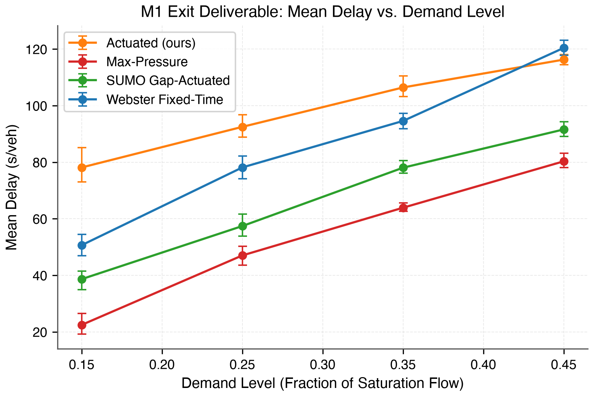

# Traffic Control Research Lab

A research platform for **adaptive traffic signal control**, built to study how control
strategies behave as traffic, sensing, and network conditions get progressively more
realistic — with motorcycle-heavy traffic as a first-class concern rather than an afterthought.

> **The simulator is a scientific instrument, not the final product.**

---

## Status: M1 complete · M2 in progress

M0 and M1 are complete. M1 delivered the founding vertical slice with all 16 tickets closed
([`tickets/M1/README.md`](tickets/M1/README.md)) and full baseline validation across 240 paired simulation runs.

| | |
| --- | --- |
| **Done** | M0 (prior art, spikes, baseline), M1 (single intersection, oracle sensor, honest baselines) |
| **Now** | M2 — trace format and 2D replay renderer |
| **Decisions** | 25 settled · 4 deferred · 1 superseded · 2 open · [`04_DECISION_REGISTER.md`](docs/04_DECISION_REGISTER.md) |
| **Open decisions** | D-021 (estimation, blocks M3) · D-024 (objective, blocks M6) |

### ▸ Headline result



*Figure: Mean vehicle delay (s/veh) across four demand levels ($d \in [0.15, 0.25, 0.35, 0.45]$) on 15 paired seeds with 95% BCa confidence intervals. Full report: [`research/M1_baseline_report.md`](research/M1_baseline_report.md).*

| Demand Level | Webster fixed-time | Actuated (ours) | SUMO gap-actuated | Max-Pressure |
| :--- | :---: | :---: | :---: | :---: |
| **0.15 (Light)** | 50.67 s [50.4, 50.9] | 55.45 s [55.1, 55.8] | 37.24 s [37.1, 37.4] | **22.48 s [22.4, 22.6]** (-55.6%) |
| **0.25 (Moderate)** | 78.11 s [77.5, 78.7] | 80.89 s [80.4, 81.4] | 64.44 s [64.0, 64.9] | **47.04 s [46.8, 47.3]** (-39.8%) |
| **0.35 (Heavy)** | 94.57 s [93.8, 95.4] | 96.11 s [95.3, 97.0] | 76.71 s [76.0, 77.4] | **63.91 s [63.4, 64.4]** (-32.4%) |
| **0.45 (Near-capacity)** | 120.42 s [119.1, 121.8] | 116.32 s [115.1, 117.5] | 94.52 s [93.4, 95.6] | **80.32 s [79.4, 81.2]** (-33.3%) |

---

## What this is

Six components, deliberately separated so that a failure can be attributed to one of them:

1. **Simulation** — SUMO as the backend, behind a project-owned adapter. We do not build a
   microsimulator; SUMO already is one.
2. **Sensing** — synthetic cameras that deliberately withhold information from controllers.
3. **Estimation** — what the control system *believes* is happening, distinct from what is.
4. **Control** — from Webster fixed-time and Max-Pressure through MPC to reinforcement
   learning.
5. **Experimentation** — every result reproducible from a configuration file and a seed.
6. **Visualization** — 2D replay that shows not just traffic, but what the controller
   believed and why it acted.

### The idea the architecture is built around

**Controllers never see true state.** Not "should not" — *cannot*. The oracle condition is
implemented as a *sensor* that returns perfect observations, not as a bypass, so a controller
receives estimated state in every experimental arm and `TrueState` is never in scope in the
control package at all. There is no path to leak through because there is no path.

That is what makes it possible to ask the questions this project exists for: when a controller
underperforms, is it the control policy, the sensor, or the estimator?

---

## Reading order

The documents build on each other. Read them in this order; each says what it supersedes.

| # | Document | What it answers |
| --- | --- | --- |
| 00 | [Research Specification](docs/00_RESEARCH_SPECIFICATION.md) | The original vision. Partially superseded — read its header first. |
| 01 | [Critical Review](docs/01_CRITICAL_REVIEW.md) | What in that vision was contradictory, missing, or over-scoped. |
| 02 | [Project Charter](docs/02_PROJECT_CHARTER.md) | **Governs scope.** Deliverable, in/out, success criteria. |
| 03 | [Roadmap](docs/03_ROADMAP.md) | Milestones, each a vertical slice exiting on a result. |
| 04 | [Decision Register](docs/04_DECISION_REGISTER.md) | Every decision: settled, open, deferred, with revisit triggers. |
| 05 | [Domain Model](docs/05_DOMAIN_MODEL.md) | The canonical vocabulary and its mapping to SUMO. |
| 06 | [Architecture](docs/06_ARCHITECTURE.md) | Layers, the three seams, the observation boundary. |
| 07 | [Experiment Methodology](docs/07_EXPERIMENT_METHODOLOGY.md) | Metrics, seeds, statistics, validity. **Binding on every experiment.** |
| 08 | [Agent Handoff Protocol](docs/08_AGENT_HANDOFF_PROTOCOL.md) | How work is delegated without silently losing methodology. |

**In a hurry?** Read 02 for what this is, then 04's index for what has been decided.

---

## Repository layout

Per [`D-014`](docs/04_DECISION_REGISTER.md#d-014). No directory exists before code goes into it.

```text
docs/               the numbered documents above
tickets/M0/         spike tickets — prior art, SUMO semantics, performance, footguns
tickets/M1/         builder tickets — the founding vertical slice, with a status table
research/           spike findings and per-milestone results documents
spikes/             throwaway code from spikes; never imported, not linted
traffic_lab/        the package: domain/, control/, experiments/ so far
tests/              mirrors traffic_lab/, one directory per package
configs/            experiment configurations (YAML)
```

---

## Getting started

SUMO installs from PyPI as the `eclipse-sumo` distribution, pinned in `uv.lock` — **not** from
Homebrew, which fails on this machine (untrusted tap, and an Intel prefix whose SUMO would
not load into an arm64 Python). `SUMO_HOME` is not needed. See
[`research/M0_environment.md`](research/M0_environment.md).

```bash
curl -LsSf https://astral.sh/uv/install.sh | sh   # installs to ~/.local/bin
uv sync
uv run python -c "import traci, libsumo, sumolib; print('ok')"
uv run traffic-lab run configs/smoke.yaml
```

`libsumo` is not optional — [D-002](docs/04_DECISION_REGISTER.md#d-002) depends on it for
roughly a 10× speedup on the simulation call path, which is what makes large seed sweeps and
RL training affordable. **Never add `pyarrow`**: it collides with libsumo's bundled libarrow
([D-004](docs/04_DECISION_REGISTER.md#d-004)), and a test fails if it is installed.

### Checks

What every ticket's Definition of Done means by "the checks pass":

```bash
uv run ruff check .
uv run ruff format --check .
uv run mypy
uv run pytest
```

`mypy` is strict over `traffic_lab/` and `tests/` from `pyproject.toml`; no flags needed.
Parallel agents each work in their own git worktree with their own `uv sync`
([`08_AGENT_HANDOFF_PROTOCOL.md`](docs/08_AGENT_HANDOFF_PROTOCOL.md) §5.1).

---

## Principles that are not negotiable

Everything else is a decision with a revisit trigger. These are the constraints the project
would stop being research without:

1. **Truth, observation, and estimate are separate**, and the separation is structural rather
   than disciplinary.
2. **The oracle arm always runs** alongside any sensed arm, so failures can be attributed.
3. **Baselines before advanced methods.** No controller is reported without Webster
   fixed-time, actuated, and Max-Pressure on identical seeds. A badly tuned baseline
   manufactures improvement out of nothing.
4. **Complexity must be earned** — by an experiment that needs it, not by realism being
   available.
5. **Every result is reproducible** from a configuration, a seed, and a recorded manifest.
6. **Null results are deliverables.** "We measured it and it did not matter, here is the
   evidence" is a finding.

---

## Scope boundaries worth knowing up front

This project does **not** build a microsimulator, does not process camera pixels (a reserved
extension point, not a current goal), and does not calibrate against real Bogotá measurements.
Every claim it makes is about the simulated environment. See
[charter §7.2](docs/02_PROJECT_CHARTER.md) for the full list and the reasoning.
